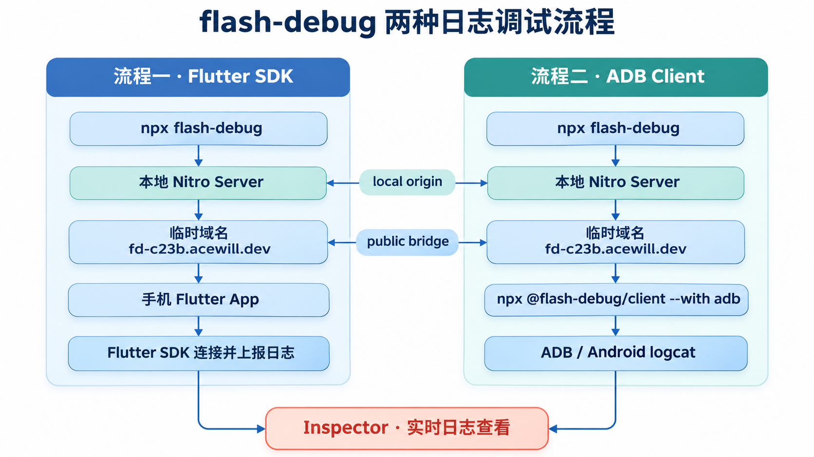

# 06 · Inspector 前端页面设计

## 目标

Inspector 是 `flash-debug` 的浏览器调试台。它把 Flutter SDK 上传的日志、ADB/logcat 日志和未来其他来源统一放在一个高密度的实时界面里。

第一版页面优先解决三件事：

1. 用户能快速确认当前 Tunnel、服务和日志来源是否在线；
2. 用户能在大量日志中快速定位错误、来源和设备；
3. 用户能展开一条完整日志查看正文和上下文，同时继续接收后续日志。

Inspector 通过同源 Nitro API 工作。页面本身不要求用户再输入公网地址；`baseUrl` 和上传 token 属于 Flutter 客户端的连接设置。ADB 来源由本地 `flash-debug` 进程直接接入。

现有两条日志路径如下，Inspector 是它们的共同出口：



## 页面信息架构

```text
Inspector
├── App Header
│   ├── 品牌和当前项目
│   ├── Tunnel / Server 状态
│   ├── 连接设备数量
│   └── 设置、复制连接信息、结束会话
├── Source Rail
│   ├── All logs
│   ├── Flutter SDK
│   ├── ADB / Android
│   └── 设备列表
├── Log Workspace
│   ├── 查询和过滤工具栏
│   ├── SSE 连接状态
│   ├── 日志列表
│   └── 暂停 / 继续跟随 / 清空视图
└── Detail Drawer
    ├── 日志完整内容
    ├── 错误和 StackTrace
    ├── 属性和设备信息
    └── 复制 JSON
```

## 核心布局

桌面宽度达到 1200px 时采用三栏布局：

```text
┌─────────────────────────────────────────────────────────────────────┐
│ Flash Debug Inspector       Connected · 2 devices       [Settings] │
├───────────────┬───────────────────────────────────────┬─────────────┤
│ SOURCES       │ LOGS                                  │ DETAIL      │
│               │ [search] [level] [source] [pause]     │ selected    │
│ All logs  324 │                                       │ event       │
│ Flutter   214 │ 10:42:31.120  INFO  Flutter  login  │ timestamp   │
│ Android  110  │ 10:42:31.186  ERROR ADB      crash  │ source      │
│               │ 10:42:31.204  DEBUG Flutter  retry  │ attributes   │
│ DEVICES       │                                       │ stacktrace   │
│ Pixel 8       │                               [new logs 12]          │
│ emulator      │                                       │             │
└───────────────┴───────────────────────────────────────┴─────────────┘
```

栏宽建议：

- Source Rail：220px；
- Detail Drawer：320px，未选择日志时收起；
- Log Workspace：占据剩余宽度；
- Header：56px；
- 日志行高度：36～44px，避免卡片堆叠造成视觉噪声。

## 页面状态

### 1. Welcome / Idle

没有活跃日志时显示简洁的启动状态：

- 当前服务地址；
- Tunnel 状态；
- 已注册日志来源；
- `Waiting for logs` 空状态；
- `flash-debug` CLI 下一步提示。

不在 Inspector 页面放置 Flutter `baseUrl` 输入框。移动端连接配置与浏览器查看是两个角色，混在同一页会让连接关系不清晰。

### 2. Connecting

连接阶段显示一个明确的步骤状态：

```text
Starting local server     ✓
Connecting Tunnel         ✓
Waiting for log sources   …
Opening Inspector         ✓
```

页面可以先打开，再通过 SSE 等待数据，不需要阻塞在空白加载页。

### 3. Connected

Connected 状态显示：

- 当前会话 ID；
- Tunnel 公网地址；
- Server 本地地址；
- 在线设备数量；
- 最近一条日志时间；
- SSE 传输连接是否正在重连。

### 4. Reconnecting

保留已有日志，顶部显示非阻塞提示：

```text
Connection interrupted · retrying in 3s
```

恢复后使用 cursor 或 `Last-Event-ID` 补齐缺失事件，不清空当前列表。

### 5. Expired / Error

Tunnel 过期、服务退出或 token 失效时，日志仍然可读；页面将实时区域切换为错误状态，并提供：

- 失败原因；
- 最后一次成功时间；
- 重新连接；
- 复制诊断信息。

## 日志列表

每行只展示定位问题所需的字段：

```text
10:42:31.186   ERROR   ADB      Pixel 8    App crashed: Null check
```

字段顺序：

1. 相对紧凑的时间戳；
2. level badge；
3. source badge；
4. tag；
5. 设备名或 deviceId；
6. 单行截断的 message。

日志正文使用等宽字体，页面标题、筛选器和状态使用普通 UI 字体。错误级别使用左侧细色条和红色 level badge，不使用整行红色背景。

点击日志行后打开 Detail Drawer。抽屉显示完整 message、error、StackTrace、attributes、sessionId、deviceId 和原始 JSON，并提供复制按钮。日志正文不会在列表中展开或分片更新。

详情查看器根据 `contentFormat` 或内容检测选择展示语言：

- JSON / JSONC / JSONL：使用 JSON 语言和折叠；
- YAML：使用 YAML 语言；
- ANSI：保留终端颜色；
- Text：使用纯文本，不做语法高亮。

`modern-monaco/core` 只在详情弹窗打开时加载。列表保留摘要和元数据，详情查看器只维护当前选中的一条日志内容。

## 工具栏和过滤

第一版工具栏包含：

- 文本搜索：匹配 tag、message、deviceId；
- Level：All / Debug / Info / Warning / Error；
- Source：All / Flutter / ADB / Server；
- Device：All 或指定设备；
- Pause：暂停视图滚动，不暂停服务端接收；
- Follow：恢复自动滚动到底部；
- Clear view：只清空当前页面，不删除服务端 JSONL。

搜索和筛选在浏览器本地执行，避免每次输入都请求 API。历史数据过大时再增加服务端 cursor 查询。

## 自动滚动规则

- 用户位于底部附近时，新日志自动滚动；
- 用户向上阅读历史时，自动滚动关闭；
- 新日志数量在列表上方显示为 `New logs 12`；
- 点击提示后跳到底部并恢复 Follow；
- Pause 只影响渲染，不影响接收、缓存和断线恢复。

第一版保留最近 5000 条渲染记录，超过后从最旧记录开始淘汰。实现虚拟列表前，先控制单行内容长度和 DOM 数量。

## Source Rail

Source Rail 不展示复杂图表，只展示当前来源和数量：

```text
ALL SOURCES       324
Flutter SDK       214
ADB / Android     110

DEVICES
● Pixel 8         88
● emulator-5554   22
```

设备在线状态使用小圆点：绿色在线、黄色授权中、灰色离线。点击设备后自动添加 device 过滤条件，仍保留 All sources 入口。

## 视觉方向

页面风格参考 `D:\Projects\ontology\viewer`，采用固定的深色玻璃面板风格。Inspector 只提供暗色界面，不做浅色主题和主题切换。

核心视觉特征：

- 顶部固定玻璃面板；
- 左侧来源和设备筛选栏；
- 右侧详情抽屉；
- 细边框、轻阴影和适度背景模糊；
- 深色点阵背景；
- 紫色作为唯一品牌强调色；
- 图标按钮使用透明底和悬停高亮。

核心色板：

| 用途 | 颜色 |
| --- | --- |
| 页面底色 | `#111319` |
| 面板底色 | `#1B1D26` |
| 半透明面板 | `rgb(23 23 23 / 92%)` |
| 边框 | `rgb(255 255 255 / 10%)` |
| 主文字 | `#ECECF2` |
| 次要文字 | `#A2A4AE` |
| 弱文字 | `#686C79` |
| 品牌紫 | `#A99BFF` |
| 品牌紫高亮 | `#9386F5` |
| 品牌紫浅底 | `rgb(124 108 242 / 16%)` |
| 在线绿 | `#3BB77D` |
| Warning | `#E4B95E` |
| Error | `#F07878` |

视觉规则：

- 少用大面积渐变；渐变只用于品牌标记或空状态；
- 主要信息靠布局、字号和颜色层级表达，不依赖阴影；
- 面板使用细边框，不使用厚重卡片；
- 日志区保持高密度，详情区保持留白；
- 所有状态都同时有文字和颜色，不只用颜色传达含义。

页面根节点固定使用 `color-scheme: dark`，不提供主题选择器，也不维护 light/dark 两套 token。

## 详情编辑器主题

日志详情弹窗统一使用 `modern-monaco/core`，只加载一个 Shiki 暗色主题：

```text
Theme: vitesse-dark
```

`modern-monaco/core` 只在详情弹窗打开时懒加载。预加载的语言包括：

- `json` / `jsonc` / `jsonl`；
- `yaml`；
- `ansi`；
- `text`。

纯文本使用 `text` 语言，不做语法高亮，只保留等宽字体、行号和换行控制。详情编辑器默认只读，不提供主题切换，不提供编辑保存能力。

编辑器允许的基础操作：

- 鼠标或键盘选择文本；
- 复制选中内容；
- 全选；
- 查找文本；
- 滚动和折叠 JSON/YAML 节点；
- 切换换行显示。

编辑器禁止的操作：

- 输入和修改内容；
- 粘贴、剪切和删除；
- 撤销和重做；
- 保存或覆盖原始日志；
- 通过快捷键触发写入动作。

实现上使用 Monaco 的 `readOnly` 和 `domReadOnly`，保留默认上下文菜单中的复制和选择能力。

Inspector 前端安装 `modern-monaco`、`@shikijs/themes` 和 `@shikijs/langs`，由 `vitesse-dark` 作为唯一默认主题，并把 JSON/YAML/JSONL/ANSI grammar 本地打包。列表页面不加载编辑器，避免打开 Inspector 时提前加载 Monaco 和语言资源，也不依赖运行时 CDN。

## 响应式行为

### 桌面端

- 三栏布局；
- Detail Drawer 常驻或按需展开；
- Source Rail 显示来源和设备；
- 键盘快捷键支持 `/` 聚焦搜索、`Space` 暂停视图、`Esc` 关闭抽屉。

### 平板端

- Source Rail 缩为 180px；
- Detail Drawer 改为右侧覆盖层；
- 工具栏允许换行；
- 设备列表改为下拉选择。

### 移动端

- 日志列表单栏全屏；
- Header 只保留会话状态和菜单；
- Source、Device、Level 过滤改为底部抽屉；
- 日志详情改为全屏 Bottom Sheet；
- 长 message 默认折叠，点击后展开。

## 前端组件边界

```text
InspectorApp
├── SessionHeader
├── ConnectionStatus
├── SourceRail
│   ├── SourceFilter
│   └── DeviceList
├── LogWorkspace
│   ├── LogToolbar
│   ├── TransportStatus
│   ├── LogList
│   └── LogRow
├── LogDetailDrawer
└── EmptyState / ErrorBanner
```

组件只通过统一的 `DebugLogRecord` 和页面 store 通信，不直接读取 SSE 或调用 ADB。SSE、历史查询和筛选状态放在 Inspector 的数据层。

## API 对应关系

```text
GET  /healthz             → Header 连接状态
GET  /api/v1/logs         → 初始历史日志
GET  /api/v1/stream       → SSE 推送完整日志事件和会话事件
GET  /api/v1/devices      → Source Rail 设备列表
POST /api/v1/viewer/session → 浏览器 viewer cookie
```

页面启动顺序：

1. 请求会话信息和最近日志；
2. 请求设备列表；
3. 连接 SSE；
4. 按事件 ID 合并历史和实时数据；
5. 进入 Connected 或 Reconnecting 状态；每个 SSE data 都作为一条完整日志事件追加。

## 第一版不做

- 复杂图表和日志统计；
- 多窗口布局编辑；
- 远程修改 App 配置；
- 远程执行任意 ADB 命令；
- 日志全文服务端搜索；
- 用户系统和长期云端存储。

第一版先把“连接成功、日志持续到达、能快速过滤和展开详情”做好，再扩展诊断能力。

## 需要确认的视觉决策

这一版默认采用“深色三栏开发者工具”方向。下一轮实现前需要确认：

1. Inspector 是否默认打开公网 URL，还是只打开本地 URL；
2. Detail Drawer 是否默认常驻；
3. Source Rail 是否需要展示每个设备的日志计数；
4. 默认日志密度采用紧凑行还是舒适行；
5. 是否需要在 Header 中直接放二维码入口。
